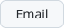
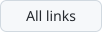
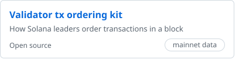
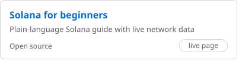
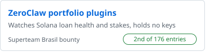
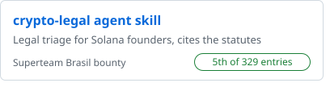

Ideas go from a first draft to a working build here, with AI writing the code and each result checked by running it or against its sources. The work below was made this way, the Superteam Earn results included. Membership in <a href="https://ua.superteam.fun/">Superteam Ukraine</a> came by invitation in August 2026.

  <a href="https://t.me/ZiBibro"><picture><source media="(prefers-color-scheme: dark)" srcset="assets/link-telegram-dark.svg"></picture></a>
  <a href="mailto:zibibroofficial@gmail.com"><picture><source media="(prefers-color-scheme: dark)" srcset="assets/link-email-dark.svg"></picture></a>
  <a href="https://superteam.fun/earn/t/ZiBibro"><picture><source media="(prefers-color-scheme: dark)" srcset="assets/link-superteam-earn-dark.svg"></picture></a>
  <a href="https://radionmaksymenko.substack.com"><picture><source media="(prefers-color-scheme: dark)" srcset="assets/link-substack-dark.svg"></picture></a>
  <a href="https://linktr.ee/zibibro"><picture><source media="(prefers-color-scheme: dark)" srcset="assets/link-all-links-dark.svg"></picture></a>

<h3>Bounty work and open source</h3>

  <a href="https://github.com/ZiBibro/solana-validator-tx-ordering"><picture><source media="(prefers-color-scheme: dark)" srcset="assets/card-1-dark.svg"></picture></a>
  <a href="https://github.com/ZiBibro/solana-for-beginners"><picture><source media="(prefers-color-scheme: dark)" srcset="assets/card-2-dark.svg"></picture></a>
  <a href="https://github.com/ZiBibro/solana-portfolio-sentinel"><picture><source media="(prefers-color-scheme: dark)" srcset="assets/card-3-dark.svg"></picture></a>
  <a href="https://github.com/solanabr/crypto-legal-skill"><picture><source media="(prefers-color-scheme: dark)" srcset="assets/card-4-dark.svg"></picture></a>

<h3>How I work</h3>

The models write the code, and my part is the product side: the solution design and a test of every build by running it.

My own product in development is MirrorDocs, a Windows app that keeps Markdown copies of office documents and PDFs so AI assistants can read a whole archive without touching the originals.

Other people's products can get a review too. After a click-through of a site or an app, its developers get notes on which parts of the UI and UX work and which features belong somewhere else.

Building the ZeroClaw plugins turned up <a href="https://github.com/zeroclaw-labs/zeroclaw/issues?q=author%3AZiBibro">nine defects in its core</a>, and each went upstream with a reproduction; eight are closed and two of the fixes are merged.

<h3>Before AI: design and a game studio</h3>

My master's degree in design (2026) is from the <a href="https://mixmd.edu.ua/">Salvador Dali Academy of Contemporary Arts</a> in Kyiv. Before AI became my main tool, my work was game environments in Unreal Engine 5 and teaching them at the academy during the second year of my master's.

While still a student, I co-founded the game studio <a href="https://x.com/RadZib_Interact">RadZib Interactive</a> and, as its CEO, led a team of 16 people across narrative, art, game design and Unreal development on the game Echoes of the Rozlom and its editor Echoes Forge. The game took an <a href="https://x.com/indiesonsolana/status/1993727728563130745">Honorable Mention in the Underdog sidetrack</a> of Colosseum Cypherpunk in November 2025, and Echoes Forge <a href="https://superteam.fun/earn/listing/dollar10000-in-rpc-infrastructure-credits-for-colosseum-frontier-hackathon">placed 7th, in the silver tier, in the RPC Fast sidetrack</a> of Colosseum Frontier in May 2026.

<h3>Research writing</h3>

<ul>
  <li><a href="https://radionmaksymenko.substack.com/p/pre-seed-fundraising-for-ukrainian"><b>Pre-Seed Fundraising for Ukrainian Solana Startups</b></a>, with a <a href="https://radionmaksymenko.substack.com/p/appendix-the-pre-seed-funding-database">funding database</a> as the appendix</li>
  <li><a href="https://radionmaksymenko.substack.com/p/the-impact-of-stablecoins-on-ukraines"><b>The Impact of Stablecoins on Ukraine's Payments Industry</b></a></li>
  <li><a href="https://radionmaksymenko.substack.com/p/business-case-for-solana-saas-ugc"><b>Business Case for Solana SaaS: UGC Gaming Marketplace</b></a></li>
  <li><a href="https://radionmaksymenko.substack.com/p/solana-native-legal-risk-on-chain"><b>Solana-Native Legal Risk</b></a>, on-chain liability in the US and the EU, plus Brazil*</li>
</ul>

All of my writing lives on <a href="https://radionmaksymenko.substack.com">Substack</a>.

* Informational only, not legal advice.

